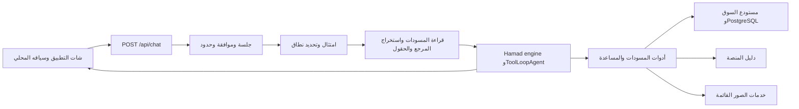

# وضع شات حمد قبل الترحيل

السيرفر `9d4666c731d8a3757ff5088885c63828b26bb85b` والتطبيق `f62fe30`. اكتملت مجموعة خط الأساس المختارة بـ141 حالة تشغيل ونجحت كلها. اختبار سرد مسودات صاحب الحساب الجديد فشل قبل إدخال المسار التجريبي لأنه لم يجد القائمة في الرد. [الجرد السابق للتعديل](01_INVENTORY.md)

- منطق الاستدلال القديم موجود في `draft-selection.ts` و`draft-edits.ts` في السيرفر. كان معروفًا أن الجمع بين الوصف والسعر قد يؤدي إلى حفظ الوصف فقط. فحص الرجوع يحافظ على المسار كما هو إلى أن تعتمد التجربة البديلة.
- مزود DeepSeek في `agent/deepseek-provider.ts` ويقرأ ملفات تعريف الحوار والتحقق والرؤية من الإعدادات الحالية. النموذج الافتراضي المعرف لهذه الأدوار هو `deepseek-flash`.
- التطبيق يحتفظ بالسجل النصي ورمز الذاكرة المشروط بالشكل `payload.mac` مخزنًا لكل حساب. ما زال التحقق من نسخة متجر موقّعة على هاتف منفصل خطوة مستقلة.
- المرشح للاستبدال هو المسار اللغوي داخل شات حمد. تبقى مستودعات الإعلان ودليل السياسات ونظام الوسائط والترجمة المحلية للمصادقة مشتركة مع بقية المشروع.
