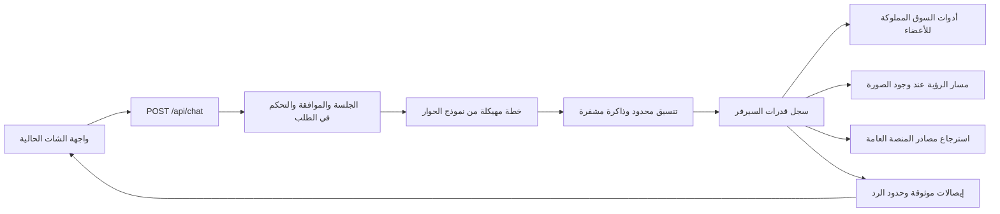

# معمارية حمد بعد الاعتماد

الطبقة مشتركة مع SSE الحالي. يُرسل حدث البدء مبكرًا، ويظهر النص بعد التحقق. استدعاء الحوار يحدد النية ويقترح الإجراء في مخرج مهيكل واحد. يبدأ فحص الكتابة عندما تكون هناك حقول ملائمة، وفهم الصور عندما تكون الصورة ذات صلة، واسترجاع المعرفة عند سؤال المنصة. اختيار فئة ناقصة له دور مشروط من سجل الفئات الحالي. لا ينفذ النموذج SQL أو إجراءات النشر.

تُعرض بيانات خيارات المسودات مباشرة من الخادم. تظهر قائمة نصية للإصدارات السابقة وتستخدم إصدارات التطبيق الداعمة بطاقات قابلة للاختيار. [مسار الطلب](../app/api/chat/route.ts) · [المُنسّق](../lib/chat/hamad-structured-turn.ts) · [الأدوار](../lib/chat/hamad-structured-model.ts)
